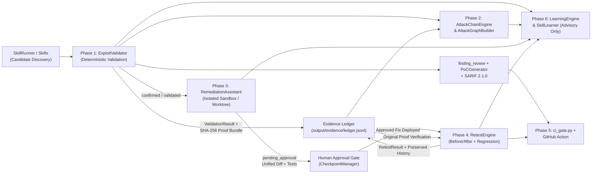

# Moros AI — Phases 1–6 Implementation Design

**Document Version:** 2.4.0  
**Target Baseline:** Post-Phase 0 Audit ([`docs/ROADMAP_AUDIT.md`](ROADMAP_AUDIT.md))  
**Scope:** Technical design for Exploit Validation (Phase 1), Attack Chain Correlation (Phase 2), Controlled Remediation (Phase 3), Retesting (Phase 4), CI/CD Integration (Phase 5), and Continuous Learning Governance (Phase 6).

---

## 1. End-to-End Architecture & Data Flow

Phases 1–6 extend Moros AI from candidate discovery into a closed-loop, evidence-backed vulnerability lifecycle while keeping all security boundaries (`ScopeValidator`, `ScopedHttpClient`, `CheckpointManager`, `LocalSandbox`, secret redaction, and prompt-injection defenses) non-bypassable.

---

## 2. Unified Finding Lifecycle State Machine

Implemented in [`tools/finding_dedupe.py`](../tools/finding_dedupe.py) (`LIFECYCLE_STATES` and `resolve_finding_lifecycle()`), [`tools/exploit_validator.py`](../tools/exploit_validator.py) (`VALID_VALIDATION_STATUSES`), and [`tools/retest_engine.py`](../tools/retest_engine.py) (`VALID_RETEST_OUTCOMES`, `update_finding_lifecycle()`):

| State | Source | Meaning | Verification Requirement |
| :--- | :--- | :--- | :--- |
| `candidate` | Discovery / default | Unverified lead | Default state; forced whenever proof/human record is absent or LLM-only. |
| `validating` | Phase 1 | Validation in progress | Machine `validation_result.status == "validating"`. |
| `confirmed` | Phase 1 | Deterministically reproduced by engine | Requires deterministic `validation_result` with non-empty `proof_artifact` and `evidence_ids`. |
| `validated` | Human triage | Reproduced and verified by human operator | Requires `validation_record.verified_by` starting with `"human:"`, non-empty `method`, non-empty `evidence_ids`, and `outcome == "reproduced"`. |
| `inconclusive` | Phase 1 / Phase 4 | Insufficient signal, budget exhaustion, scope/HITL block, or env mismatch | Never promoted to `confirmed` or `fixed`. |
| `false_positive` | Phase 1 / Human | Refuted by deterministic negative evidence or human review | Excluded from active attack chains and CI failure gates. |
| `fixed` | Phase 4 / Human | Original confirmed/validated finding no longer reproduces on retest | Preserves historical `evidence_ids`, `proof_artifact`, `validation_result`, and appends `FIXED_LIMITATION_NOTE`. |
| `accepted_risk` | Human-only | Risk formally accepted by an operator | Strictly human-only (`validation_record`); `ReproductionRunner` explicitly blocks automated assignment. |

### Precedence & Anti-Inflation Rules
- **Precedence (`_LIFECYCLE_PRECEDENCE`):** `accepted_risk` (7) > `fixed` (6) > `false_positive` (5) > `validated` (4) > `confirmed` (3) > `validating` (2) > `inconclusive` (1) > `candidate` (0).
- **LLM-Only Guard (`_resolve_machine_result`):** Any `validation_result` with `deterministic: false`, `llm_only: true`, or `method == "llm_only"` is rejected and forced back to `("candidate", "unverified")`.
- **Human vs. Machine Separation:** Machine confirmation (`confirmed`) never overwrites human `validation_record` semantics (`validated`), and `accepted_risk` can never be set by automated runs.

---

## 3. Phase-by-Phase Technical Design

### 3.1 Phase 1 — Exploit Validation Engine (`tools/exploit_validator.py`)

- **Core Classes:**
  - `ValidationResult`: Dataclass storing `finding_id`, `validation_run_id`, `target`, `endpoint`, `method`, `strategy`, `strategy_version`, `status`, `confidence` (`0.0`–`1.0`), `limitations`, `environment`, `timestamp`, `evidence_ids`, `proof_artifact`, `reproduction_steps`, `requests_used`, and `details`.
  - `ValidationStrategyRegistry`: Deterministic strategies (`1.0.0`) for 9 core classes plus generic predicate replay:
    `xss-reflected`, `sqli-heuristic`, `open-redirect`, `cors-audit`, `path-traversal`, `ssrf-identify`, `idor-audit`, `ssti-detect`, `crlf-injection`, and `generic-replay`.
  - `ReproductionRunner`: Executes strategies strictly through `ScopedHttpClient`, `ScopeValidator`, `CheckpointManager`, `OOBServer`, `AuthDiffChecker`, and `FalsePositiveFilter`.
  - `ProofRecorder`: Sanitizes request/response headers, cookies, query tokens, and body previews; writes proof bundles to `output/evidence/validation/<validation_run_id>.json` (`schema_version: "1.0"`); and appends SHA-256 provenance entries (`evidence_type: "validation_proof"`, `evidence_id: "ev-<sha256[:16]>"`) to `output/evidence/ledger.jsonl`.
  - `ExploitValidator`: Coordinates `validate_finding()`, `validate_findings()`, and `reproduce_from_proof()` (verifying ledger SHA-256 before replay) within shared request/time budgets.
- **Downstream Integrations:**
  - `tools/finding_review.py`: `review_candidates()` remains non-invasive (`network_requests: 0`) and maps `confirmed`, `validated`, `fixed`, `false_positive`, `accepted_risk`, `validating`, `inconclusive`, and `candidate` via `resolve_finding_lifecycle()`.
  - `tools/poc_generator.py`: `is_poc_eligible()` accepts `confirmed` and `validated`; `generate_poc()` supports `GET`/`HEAD`/`POST`/`PUT`/`PATCH`/`DELETE`/`OPTIONS`, JSON/form bodies, and redacts credentials/cookies/tokens.
  - `tools/sarif_exporter.py`: Records lifecycle state and verification source (`machine`, `human`, `retest`, `none`) in SARIF rule/result metadata.

### 3.2 Phase 2 — Correlated Attack Chain Engine (`tools/attack_chain.py`, `tools/attack_graph.py`)

- **Core Classes:**
  - `FindingRelationshipGraph`: Typed graph over `NODE_TYPES = ("asset", "endpoint", "identity", "finding", "evidence", "attack_step", "remediation")` with explicit `trust_boundaries` and deduplication via `_dedupe_findings_preserve_status()`.
  - `AttackPathAnalyzer`: Orders security primitives along an acyclic rank (`PRIMITIVE_RANK`) and evaluates `TRANSITION_RULES` only when an explicit technical anchor exists (`same_endpoint`, `same_host`, `same_site`, `shared_params`, `shared_identity`, or `explicit_service_target`). Inactive findings (`false_positive`, `fixed`, `verified_negative`) are excluded.
  - `AttackPathScorer`: Computes `path_risk_score` (`0.0`–`10.0`), `path_severity`, `impact_score`, `chain_completeness`, `confidence`, and `evidence_quality` independently while preserving `original_finding_severities` untouched.
  - `AttackChainEngine` & `AttackGraphBuilder`: `load_target_artifacts()` reads `SkillRunner` outputs (`recon/subdomains-all.txt`, `js/endpoints.json`, `js/parameters.json`, `api/endpoints.json`, `findings/{confirmed,validated,candidates}-*.json`, `evidence/ledger.jsonl`) as well as legacy paths, writing `output/report/attack-graph.json` and `output/report/attack-chains.json`.
- **Verified vs. Inferred Semantics:** Every edge carries `evidence_ids`, `confidence`, `verified`, `inferred`, `explanation`, `created_at`, and `source_component`. Mermaid diagrams render verified edges as solid (`-->`) and inferred edges as dashed (`-.->|... [inferred]|`). Missing prerequisites and uncertainty reasons are surfaced per chain.

### 3.3 Phase 3 — Remediation Assistant (`tools/remediation_assistant.py`)

- **Core Classes:**
  - `CodeContextAnalyzer`: Resolves files strictly inside `repo_root` (`SecurityBoundaryError` on traversal), extracts enclosing Python functions via `ast`, treats repository files and `README*` as untrusted data via `detect_injection()` and `sanitize_for_prompt()`, and redacts secrets.
  - `RootCauseAnalyzer`: Deterministically maps vulnerability classes (`sqli`, `xss`, `path_traversal`, `command_injection`, `open_redirect`, `ssti`, `ssrf`, `idor`, `secret`) to CWE, root cause, violated invariant, and recommended fix (with optional, spotlighted LLM enrichment).
  - `PatchGenerator` & `PatchSafetyReviewer`: Generates minimal single-file unified diffs (`apply_unified_diff_to_text()`), enforces `ast.parse()` on Python targets, and rejects diffs containing unrelated files, traversal paths, excessive hunks/lines, empty/comment-only edits, `eval`/`exec`/`pickle`/`os.system`/`shell=True`, prompt injections, incomplete fixes, or hardcoded secrets.
  - `PatchTestRunner`: Applies the diff inside an isolated `LocalSandbox` copy or detached `git worktree` and runs regression tests without mutating the main repository.
  - `RemediationReport` & `RemediationAssistant`: Refuses unconfirmed findings by default (`require_confirmed=True` raises `UnconfirmedFindingError`), returns `approval_status="pending_approval"`, integrates optional `CheckpointManager` requests (`request_approval_checkpoint()`), and gates `approve_and_create_branch()` strictly behind explicit `human:<id>` approval or an `APPROVED` checkpoint. Branch creation writes a local git branch pointer at `HEAD` only—never auto-committing, never pushing, and never modifying working tree files.

### 3.4 Phase 4 — Retesting Engine (`tools/retest_engine.py`)

- **Core Classes:**
  - `RetestPlanner`: Builds `RetestPlan` linking finding, `remediation_id`, `code_version`, `environment`, and original proof bundle while verifying original SHA-256 ledger integrity (`ProofRecorder.verify_proof_integrity()`).
  - `BeforeAfterComparator`: Compares original proof exchanges vs. retest exchanges (HTTP status, security headers, body similarity, reflection/SQL/traversal markers, OOB callbacks, auth diffs) and flags endpoint/environment mismatches or `404`/`410`/network errors as `inconclusive`. Refuses to claim `fixed` if the original finding was not `confirmed` or `validated`.
  - `RegressionAnalyzer`: Checks baseline/probe exchanges and bounded `GET` regression routes for HTTP 5xx, stack traces, functionality breakage, or reintroduced vulnerability signatures.
  - `RetestRunner` & `RetestEngine`: Enforces preflight scope and HITL checks, invokes `ReproductionRunner`, persists `RetestResult` to `output/evidence/retests/<retest_id>.json` (`schema_version: "1.0"`) with a SHA-256 `ledger.jsonl` entry (`evidence_type: "retest_result"`), and updates finding state via `update_finding_lifecycle()`.
- **Evidence Preservation & Fixed Limitation:** `update_finding_lifecycle()` never overwrites or deletes historical `evidence_ids`, `proof_artifact`, or `validation_result`; it appends immutable entries to `finding["retest_history"]`. Any `outcome == "fixed"` automatically includes `FIXED_LIMITATION_NOTE`: *"Does not prove the entire application is secure; only that the specific tested issue was not reproduced under the recorded conditions"*.

### 3.5 Phase 5 — GitHub & CI/CD Integration (`tools/ci_gate.py`, `.github/actions/moros-scan/action.yml`)

- **Policy Gate (`tools/ci_gate.py`):**
  - `GateConfig`: `min_severity` (`info|low|medium|high|critical`), `fail_on_candidate`, `fail_on_confirmed`, `min_confidence` (`0.0`–`1.0`), `require_validation`. Supports JSON/YAML config files (`--config`) and CLI overrides.
  - **Scope Guard (`--check-scope`):** `validate_authorized_scope()` blocks active CI scans unless `scope-of-work.*` explicitly names the target and authorization keywords, and `ScopeValidator` permits active checks.
  - **SARIF Validation (`--validate-sarif`, `--strict-sarif`):** Verifies SARIF 2.1.0 schema fields and checks `message.text` for unredacted secret material.
  - **Redacted PR Summary (`--summary-out`):** `generate_pr_summary()` emits Markdown tables sanitized via `redact_sensitive_text()`.
  - **Distinct Exit Codes:** `0` (pass), `2` (policy gate triggered), `3` (scope/authorization violation), `4` (invalid configuration, missing/malformed artifacts, or scan execution failure).
- **GitHub Action & Workflows:**
  - Composite Action: [`.github/actions/moros-scan/action.yml`](../.github/actions/moros-scan/action.yml) wraps scope guard, `run.py`, `tools/ci_gate.py`, and SHA-pinned `github/codeql-action/upload-sarif`.
  - Example Workflows: [`.github/workflows/moros-dast-example.yml`](../.github/workflows/moros-dast-example.yml) and [`.github/workflows/moros-retest-example.yml`](../.github/workflows/moros-retest-example.yml) use SHA-pinned actions and guard against untrusted fork PRs (`github.event.pull_request.head.repo.full_name == github.repository`) plus explicit `vars.MOROS_AUTHORIZED_TARGET` matching.

### 3.6 Phase 6 — Continuous Learning & Skill Governance (`learning_engine/engine.py`, `tools/skill_learner.py`)

- **Learning Engine (`learning_engine/engine.py`):**
  - **Additive Outcome & Telemetry Ingestion:** `record_validation_outcome()`, `record_remediation_outcome()`, `record_retest_outcome()`, `record_tech_fingerprint()`, `record_skill_telemetry()`, and `record_attack_path()` persist provenance (`run_id`, `evidence_ids`, timestamps) in SQLite without weakening `triage` verdict validation (`confirmed`, `false_positive`, `unverified`).
  - **Advisory-Only Queries:** `recommend_skills_for_tech()`, `recommend_validation_strategies()`, `estimate_scan_value_and_cost()`, `recommend_regression_tests()`, and `get_advisory_patterns()` return non-binding hints only.
- **Skill Proposal Governance (`tools/skill_learner.py`):**
  - `draft_proposal()` and `propose_skills()` always persist proposals with `approved=False`, `enabled=False`, `status="pending"`, monotonic `version`, `supersedes_proposal_id`, and provenance (`source_runs`, `source_evidence_ids`, `trace_span_ids`).
  - **Explicit Lifecycle Controls:** `approve_proposal()` (required before activation under `skills/`), `disable_proposal()`, `enable_proposal()` (refuses unapproved/pending/rejected/rolled-back proposals), `rollback_proposal()` (revokes approval, archives and removes from `skills/`, optionally restores a previously approved version), and `reject_proposal()`. `CORE_SKILLS` are protected from modification or removal.
  - **Immutable Security Policy Invariants (`validate_proposal_policy_invariants`):** Rejects any proposal or `SKILL.md` frontmatter containing `IMMUTABLE_POLICY_KEYS`, `_POLICY_WEAKENING_PATTERNS`, or prompt-injection payloads attempting to alter scope restrictions, tool permissions, budgets, or HITL requirements.

---

## 4. Security & Safety Boundaries Summary

1. **Network & Scope Containment:** Every validation and retest probe executes through `ScopedHttpClient` + `ScopeValidator`. Default method is `GET`/`HEAD`; state-changing methods (`POST`/`PUT`/`PATCH`/`DELETE`) require `MOROS_ALLOW_GATED_POST=1` and `CheckpointManager` HITL approval.
2. **Data Sanitization & Prompt-Injection Defense:** HTTP exchanges, source snippets, READMEs, diffs, and CI summaries pass through `redact_headers()`, `redact_secrets()`, `sanitize_output()`, `detect_injection()`, and `sanitize_for_prompt()`.
3. **Isolation & Human Governance:** Remediation patches run in `LocalSandbox` / detached `git worktree` and require human approval before creating a local branch; learned skills require human approval before activation and can be disabled or rolled back at any time.

---

## 5. Backward Compatibility & Migration Notes

- **Unverified Findings Preserved:** Existing discovery outputs (`output/findings/*/candidates-*.json`) without `validation_result` or `validation_record` continue to resolve to `status="candidate"` and `validation_status="unverified"`.
- **Additive Schema Fields:** New fields (`validation_result`, `proof_artifact`, `retest_history`, `latest_retest`, `attack_chains`, `chain_summary`) are strictly additive; existing consumers reading `findings`, `severity`, `cvss`, and `validation_record` continue to work unchanged.
- **Exit Code Compatibility:** `run.py` preserves exit code `2` for `--fail-on-candidate` and `--ci-gate` policy triggers, while `tools/ci_gate.py` separates scope violations (`3`) from invalid configuration or missing/malformed artifacts (`4`).
- **SQLite Schema Evolution:** `LearningEngine` applies additive table/column migrations (`outcome_events`, `tech_fingerprints`, `skill_telemetry`, `attack_paths`) cleanly on existing `learning.db` instances.
